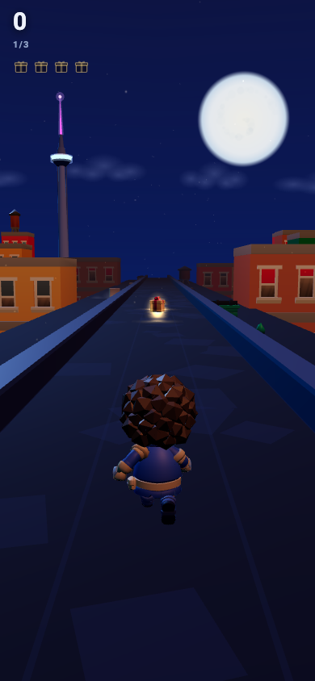
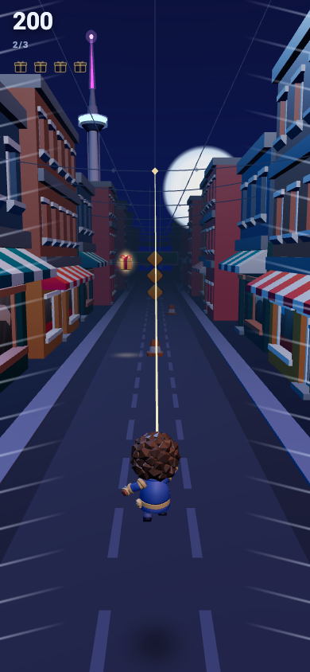
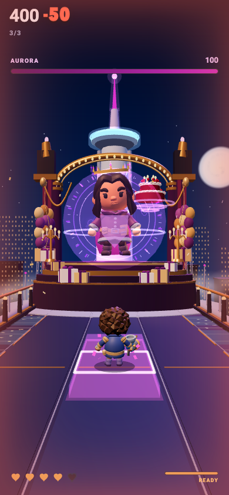

# Operation Confetti

A three-level browser game: chase a cake thief across a comic-book Toronto
and land on a leaderboard. Built in four days.

**Play it:** [operation-confetti.auritro.com](https://operation-confetti.auritro.com)
(portrait, on a phone)

<p align="center">
  
  
  
</p>
<p align="center">
  <sub>The Gift Vault, swipe left and right · Skyline Chase, swipe in four directions · Cake Showdown, dodge and tap</sub>
</p>

## The game

Aurora has stolen Matthew's birthday cake and locked the party's presents in
her vault. Level one is a rooftop run: three lanes, lasers, spotlights, a
present in every lane you'd rather not be in. Level two is a chase down a
city street on a grapple line, swinging over barricades and running under
bridges. Level three is the rooftop: Aurora, her shield, her cake, and a
confetti cannon.

A short comic runs between the levels. Tap to read it, or skip it.

## Built with

TypeScript, Three.js and plain DOM in the browser. A Cloudflare Worker serves
the static build and the score API from one origin; Supabase Postgres holds
the runs and is reached only from the Worker.

The browser never decides a score. A run is a stream of events, and one pure
function reduces it to points. The browser runs that function to show a live
number and the Worker runs the same function, from the same file, to decide
what gets stored.

Each level is a simulation with no DOM and no knowledge of the others. The
campaign shell mounts one, plays it to a result, shows the comic, and mounts
the next. Courses are data: an encounter is a lane, a time and a shape, and
the collider and the art both derive from the shape.

## Checked by

Unit tests for the simulations and the scoring. A route solver that finds a
full-score path through each course and reports how much timing slack it
has. Headless Chromium runs that replay the route with real touch gestures
at six screen sizes, mount all three levels on one renderer, and photograph
every screen so a visual change comes with a before and after. All of it
runs in CI on every pull request; deploys wait for an approval.

## How it was made

Most of the code was written by AI coding agents, directed and reviewed by
me. [`docs/DECISIONS.md`](docs/DECISIONS.md) has the choices that shaped
the code.

## Run it locally

Needs Node 22. The runtime models and story images are generated from the
source packs in `assets/`, so a clean clone builds them once.

```bash
npm ci
cp .env.example .env            # Supabase keys, only for db:push and deploys
cp .dev.vars.example .dev.vars  # the Worker's secrets for wrangler dev
npm run assets:build            # stage models, textures and story art into public/
npm run worker:dev              # terminal 1: Worker and API on :8787
npm run dev                     # terminal 2: Vite on :5173, proxies /api
```

The game plays without a database; the score API returns an error and the
run stays local.

### Review routes

| Path | Shows |
| --- | --- |
| `/` | the whole campaign |
| `/?review=story` | the comic, in order, with the real transitions |
| `/?review=chrome` | every screen that isn't a level |
| `/?ending=1`, `/?ending=2` | a level's last five seconds; add `&loop` to replay |
| `/?tutorial=N` | level N with its tutorial sheet up |
| `/?perf` | a frame-timing chip on any route |

The full table and the capture tools are in [`AGENTS.md`](AGENTS.md).

### Checks

```bash
npm test               # unit tests
npm run check:route    # the route solver
npm run check:scene    # the level 1 scene budget
npm run check:campaign # three levels on one renderer
npm run check:swing    # touch replay across six viewports
```

## Layout

```
src/core/       loop, input, lanes, lifecycle, scoring (shared with the Worker)
src/levels/     the three simulations
src/render/     scenes, cameras, environment layers, effects
src/ui/         HUD, comic player, chrome
src/story/      the comic as data
worker/         Cloudflare Worker: static host and /api
supabase/       schema
tools/          asset build, checks, capture tools, the image generator
tests/          the suite
docs/           design, decisions, the pass records
assets/         CC0 source packs and the story art
```

## Credits and licence

Code is [MIT](LICENSE).

3D assets are CC0 from [Kenney](https://kenney.nl) (City Kit Roads, Blaster
Kit, Particle Pack) and [Kay Lousberg](https://kaylousberg.com) (Adventurers,
City Builder Bits, Holiday Bits).

The two characters are real people, drawn with their permission. The
illustrations and the generated comic panels are not covered by the code
licence and aren't for reuse.
