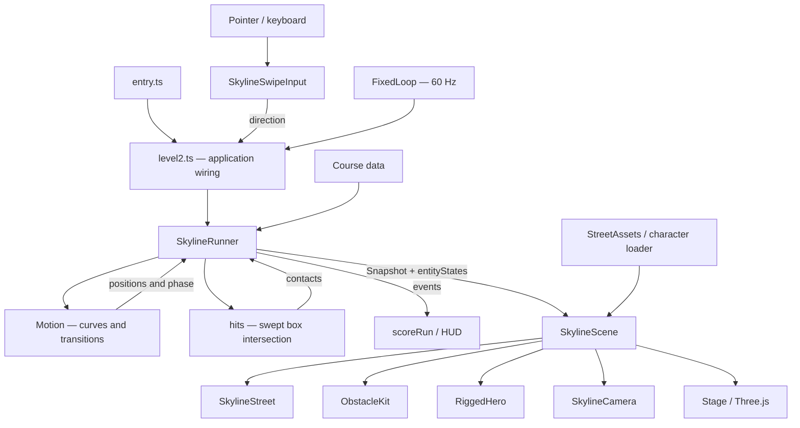

**Project state map — 5 November 2026**

Baseline: commit `2e9356a` (“Level 2: turn the props that are supposed to block the path”). This is a map of the implementation on disk, not a proposal for the next build. No gameplay or presentation source was changed for this review.

The project is a TypeScript / Three.js browser game, built with Vite. Level 1 and Level 2 have separate controllers. Level 2 is the default review entry; Level 1 is selected with `?level=1`. Level 3 has design, assets and scoring support, but no playable level implementation.

**1. Read this path first**

| Order | File | Responsibility |
|---|---|---|
| 1 | [src/entry.ts](/Users/auritrosami/Downloads/matthew-game/src/entry.ts:1) | Chooses the Level 1 or Level 2 application. |
| 2 | [src/level2.ts](/Users/auritrosami/Downloads/matthew-game/src/level2.ts:50) | Creates the scene, input, runner, loop and UI; wires them together. |
| 3 | [src/levels/skyline/types.ts](/Users/auritrosami/Downloads/matthew-game/src/levels/skyline/types.ts:1) | Defines lanes, modes, phases, course entities, motion samples and snapshots. |
| 4 | [src/core/skyline-swipe-input.ts](/Users/auritrosami/Downloads/matthew-game/src/core/skyline-swipe-input.ts:29) | Converts a pointer stroke or key press into a direction. |
| 5 | [src/levels/skyline/runner.ts](/Users/auritrosami/Downloads/matthew-game/src/levels/skyline/runner.ts:33) | Interprets direction, chooses target lane/mode and applies launch assistance. |
| 6 | [src/levels/skyline/motion.ts](/Users/auritrosami/Downloads/matthew-game/src/levels/skyline/motion.ts:23) | Produces the actual position, velocity, acceleration, phase and anchor. |
| 7 | [src/levels/skyline/runner.ts](/Users/auritrosami/Downloads/matthew-game/src/levels/skyline/runner.ts:5) | Sweeps the player collision box through each movement step. |
| 8 | [src/levels/skyline/course.ts](/Users/auritrosami/Downloads/matthew-game/src/levels/skyline/course.ts:141) | Authors the obstacle/reward sequence. |
| 9 | [src/render/skyline-scene.ts](/Users/auritrosami/Downloads/matthew-game/src/render/skyline-scene.ts:279) | Turns a snapshot and entity states into visible transforms and effects. |
| 10 | [src/render/skyline-obstacles.ts](/Users/auritrosami/Downloads/matthew-game/src/render/skyline-obstacles.ts:91), [src/render/skyline-street.ts](/Users/auritrosami/Downloads/matthew-game/src/render/skyline-street.ts:199) | Construct obstacle assemblies and the street respectively. |

The diagram is the main flow. There are extra dependencies: the renderer also imports the motion module's anchor calculation and anchor height; the street consumes a gameplay-zone constant; course gift heights are calculated with the motion module.

**2. What the state actually means**

| State | Meaning |
|---|---|
| `lane` | Selected destination lane: -1, 0, +1. Updated immediately when accepted, before the player arrives. |
| `mode` | Motion's destination mode, not necessarily the character's current physical posture. It becomes `run` when descent begins, or `swing` when launch begins. |
| `requestedMode` | Last requested vertical mode. Can be `swing` while motion remains in `run` awaiting clearance. |
| `phase` | Current movement/presentation phase: swing, flight, descend, land, run, launch or transfer. |
| `p / v / a` | Actual position, velocity and acceleration. Collision uses position, not selected lane or mode. |
| `transitioning` | Whether Motion currently has a transfer curve. |
| `pendingLaunch` | Derived from requestedMode=swing and mode=run. |
| `anchor` | A calculated target for rope/pose presentation. It does not constrain the player's movement. |
| `entityStates` | Map of entities already collected, hit or missed; absent means pending. |
| `protection` | Remaining one-second incident immunity. |
| `started / complete` | Gates simulation progression. The first directional input starts; reaching 45 seconds completes. |

There is no player HP, lethal collision, falling simulation, fail/retry state, or freeze-and-reattach mechanic in current Level 2. Incidents deduct points and forward motion continues. Those earlier ideas are historical.

**3. Controls and motion**

Input: [src/core/skyline-swipe-input.ts](/Users/auritrosami/Downloads/matthew-game/src/core/skyline-swipe-input.ts:34).

- A stroke must move at least 28 CSS pixels and have a dominant axis at least 1.25 times the other axis.
- Exactly one action is emitted per stroke. A longer swipe does not cross two lanes. Two separate swipes can.
- Left/right moves the selected target one lane, clamped at the edges. The reference is the destination lane, not the nearest lane to the current x.
- Up selects persistent swinging; down selects persistent running. Every lane supports both.
- Taps and holds do not trigger movement. Arrow keys/WASD are equivalents; repeated keydown events are ignored.
- New directions can interrupt an unfinished transfer. Repeating the same destination/mode is a no-op.
- A swipe used to resume also applies that direction. Pause and replay are handled in [src/level2.ts](/Users/auritrosami/Downloads/matthew-game/src/level2.ts:105).

Steady motion: [src/levels/skyline/motion.ts](/Users/auritrosami/Downloads/matthew-game/src/levels/skyline/motion.ts:23).

- Forward position is `z = elapsed × 8.5`.
- Lane centres are x=-3.2, 0 and +3.2.
- Running keeps the player origin at y=1.25.
- Swinging follows `y = 8 + 3 cos(2πt / 3.2)`: origin height 5–11, independent of lane.
- Each swing cycle spends its first 76% in `swing` with an anchor, then the remainder in `flight` without one.
- Upper anchors are at y=19, with z derived from the cycle. Lower anchors are calculated from a transfer's landing time.
- This is authored kinematic motion. There is no gravity integration, pendulum solver, rope-length constraint or tension calculation. The rope is drawn after movement is determined.

Transfers: [src/levels/skyline/motion.ts](/Users/auritrosami/Downloads/matthew-game/src/levels/skyline/motion.ts:57).

A quintic curve joins current position/velocity/acceleration to the destination route's future position/velocity/acceleration. This is a useful separation and preserves continuity when changing your mind.

Initial duration is `0.45 + 0.4 × min(1, lateralDistance / 6.4)`. It is lengthened if the predicted vertical difference exceeds 3 units, then potentially shortened while searching for a bounded curve.

Consequently, even a sideways swipe while remaining airborne has phase-dependent timing. Sampling a single middle-to-right change across one cycle produced approximately **0.65–1.19 seconds**. Running lane changes do not have that swing-height dependency. The reaction-time tests measure one starting phase, not the full range.

The bound search samples 32 points, tries up to 12 durations, and then accepts the last candidate. Its permitted x bound is **±5.7**, while the declared gameplay zone is **±4.6**. These are different contracts.

Launch assistance: [src/levels/skyline/runner.ts](/Users/auritrosami/Downloads/matthew-game/src/levels/skyline/runner.ts:43).

An up request while motion's target mode is run waits if an overhead hazard intersects the lateral corridor from current x to destination x and lies within a fixed 1.5-second forward lookahead. It retries automatically each simulation substep. Down cancels it. This is a clearance heuristic, not a collision sweep of the proposed launch curve. It checks all course hazards, including ones already marked hit.

**4. Collision and scoring**

Intersection implementation: [src/levels/skyline/runner.ts](/Users/auritrosami/Downloads/matthew-game/src/levels/skyline/runner.ts:5). Contact consequences: [src/levels/skyline/runner.ts](/Users/auritrosami/Downloads/matthew-game/src/levels/skyline/runner.ts:61).

The player is represented by a fixed axis-aligned box with half-extents **0.35 / 0.9 / 0.35**. Each entity box is expanded by these values. The code then intersects the line segment between the previous and next player positions against that expanded box using the slab method.

This is a sound swept-box method for a straight movement segment. The curved path is approximated by segments at **at most 1/120 second**; the outer application loop updates at 60 Hz. It avoids simply skipping through thin obstacles between frames. It is not mesh collision, a rotated body collider, or an exact continuous sweep of the quintic curve.

The same algorithm handles running, swinging, lane changes, launch and descent. There is no “if running, ignore overhead” shortcut: clearance follows actual y.

| Case | Current geometry and result |
|---|---|
| Running | Player collision height is 0.35–2.15. |
| Steady swinging | Across the cycle, player collision height occupies 4.1–11.9. |
| Ground hazard | Authored from y=0 to 3: catches a centred runner and clears steady swinging. |
| Overhead hazard | Authored from y=5 to 13: clears a runner and catches steady swinging. |
| Transition | Contact depends on the actual intermediate x/y/z. There is no transition immunity. |
| Gift | Same swept box check; collected once. Four gifts score, one teaching gift does not. |
| Hazard | Marked hit once; emits -50 only when protection is zero, then grants one second of protection. |
| Contact during protection | Still marks the hazard hit, consumes it and hides it; no extra incident event. |
| Passed entity | Marked missed after the player's swept rear clearance passes its z range. |
| Completion | At 45 seconds emits +200 once, regardless of previous hits. |

The collision body is shorter than the visible character's 2.385-unit bind-pose height and does not follow limb animation, lean or crouch. That can be a deliberate forgiving collision policy, but it is not exact visual-body contact.

`shutLane` is two separate boxes (ground and overhead), not a full-height volume. After player expansion there is a narrow centre-height interval between 3.9 and 4.1 not covered by either box; the label “every height” is therefore not a literal geometric guarantee.

Scoring lives in [src/core/scoring.ts](/Users/auritrosami/Downloads/matthew-game/src/core/scoring.ts:58): +100 scored gift, -50 incident, +200 route completion, score clamped to zero after penalties. Level 2 maximum is 600. The current entry displays local scores and does not submit a completed campaign to the backend.

**5. Assets and presentation**

| File | Responsibility and important boundary |
|---|---|
| [src/render/skyline-props.ts](/Users/auritrosami/Downloads/matthew-game/src/render/skyline-props.ts:86) | Level 2 asset registry: URLs, scales, expected heights and descriptive roles. This is the runtime prop mapping. |
| [src/render/skyline-assets.ts](/Users/auritrosami/Downloads/matthew-game/src/render/skyline-assets.ts:135) | Loads all registered GLBs; shares Kenney materials; scales/base-seats clones; bakes geometry for instancing; exposes bounds. |
| [src/render/skyline-street.ts](/Users/auritrosami/Downloads/matthew-game/src/render/skyline-street.ts:123) | Creates the full decorative street once. Hashes choose tower variants and spacing; a parent transform moves the street past the player. |
| [src/render/skyline-obstacles.ts](/Users/auritrosami/Downloads/matthew-game/src/render/skyline-obstacles.ts:91) | Infers visual archetype from collision dimensions, builds/fits props, and merges them by material. No explicit archetype field survives in Entity. |
| [src/render/skyline-hero.ts](/Users/auritrosami/Downloads/matthew-game/src/render/skyline-hero.ts:77) | Loads Matthew and animation libraries; selects run/jump clips; aims arms procedurally; reports hand position for the rope. |
| [src/render/skyline-camera.ts](/Users/auritrosami/Downloads/matthew-game/src/render/skyline-camera.ts:51) | Fixed horizontal view down the street, smoothed partial altitude tracking, portrait pullback and optional closeup. |
| [src/render/skyline-view.ts](/Users/auritrosami/Downloads/matthew-game/src/render/skyline-view.ts:35) | Camera, fog and draw-distance constants; re-exports gameplay-zone width. |
| [src/render/skyline-scene.ts](/Users/auritrosami/Downloads/matthew-game/src/render/skyline-scene.ts:107) | Composes all of the above; also owns fallback geometry, rope, anchor pools, markers, finish structure and backdrop. |
| [src/render/stage.ts](/Users/auritrosami/Downloads/matthew-game/src/render/stage.ts:23) | Shared WebGL renderer, scene, lights, camera and resize handling. Pixel ratio capped at 1.5. |
| [src/level2.css](/Users/auritrosami/Downloads/matthew-game/src/level2.css:1) / [src/ui/hud.ts](/Users/auritrosami/Downloads/matthew-game/src/ui/hud.ts:10) | Level 2 layout/styles; shared score, penalty and debug display. Level 2-specific DOM and hints are built in level2.ts. |

Coordinate convention: simulation advances toward positive z. Rendering keeps the hero at z=0 and draws an object at `playerZ - objectWorldZ`. The street achieves that with local negative-z positions plus one parent translation; entities and anchors perform the conversion separately.

Street asset usage:

- Buildings: towerA, towerC, towerE, towerG.
- Surface: road, roadCrossing; additional ground plane.
- Dressing: streetlight, trafficLight, streetSign, dumpster.
- Swing/landing presentation: anchorSpan and lowAnchor, plus procedural diamond markers and rope.
- Obstacles: barrier, cone, workLight, bridgeDeck, bridgePillar, signHanging.
- Rewards: yellow present.
- Registered/loaded but not instantiated by current scene builders: anchorWires, anchorPole, signGantry, lightHanging, fence, streetlightDouble.
- Background: shared sky/moon and procedural CN Tower. The tower remains at a fixed player-relative position rather than being a destination the player approaches.

The decorative street is already constructed once, but it is not an explicitly authored list of placements. Anchors/gantries are still drawn from a moving pool. Gameplay entities hide after contact/pass or outside their draw range. Therefore “the whole scene is fixed” does not describe the current implementation.

**6. Confirmed mismatches and unresolved contracts**

These are review findings, not changes made in this pass.

| Finding | Evidence / location | Practical consequence |
|---|---|---|
| Player can leave the supposedly exclusive gameplay zone | Motion permits ±5.7 at [src/levels/skyline/motion.ts](/Users/auritrosami/Downloads/matthew-game/src/levels/skyline/motion.ts:74); course declares ±4.6 at [src/levels/skyline/course.ts](/Users/auritrosami/Downloads/matthew-game/src/levels/skyline/course.ts:52). Production-runner probe reached x≈5.204 with inputs 0.5 seconds apart. | Decorative objects at x≈5.4 cannot safely be assumed unreachable. They have no gameplay collision. |
| Lamp arm points outward | [src/render/skyline-street.ts](/Users/auritrosami/Downloads/matthew-game/src/render/skyline-street.ts:240) applies building façade rotation. Staged lamp bounds extend along negative Z, whereas the façade points positive Z. | The lamp orientation rule is reversed; its source comment has the wrong sign. |
| Anchors and supports have no attachment relationship | [src/levels/skyline/motion.ts](/Users/auritrosami/Downloads/matthew-game/src/levels/skyline/motion.ts:30), [src/render/skyline-scene.ts](/Users/auritrosami/Downloads/matthew-game/src/render/skyline-scene.ts:352). Gantry model base is placed at anchor y=19; the model itself is ~6.825 units tall. | Equal origin heights do not align the visible wire and rope target. Nothing binds endpoints to building surfaces. |
| Bridge supports miss the deck laterally | [src/render/skyline-obstacles.ts](/Users/auritrosami/Downloads/matthew-game/src/render/skyline-obstacles.ts:144) fits deck to ±4.6, but pillar centres are ±6.2 with measured half-width ≈0.91. | Each pillar's nearest edge is ≈5.29, leaving about 0.69 units to the fitted deck. |
| Ground-obstacle art extends beyond collision depth | [src/render/skyline-obstacles.ts](/Users/auritrosami/Downloads/matthew-game/src/render/skyline-obstacles.ts:117) does not fit depth. After rotation, barrier depth is ≈1.7615 versus a single-lane collider depth of 0.9. Its z offset is 0.09. | Barrier bounds are approximately [-0.791, +0.971] locally versus collision [-0.45, +0.45]. Visible contact and collision timing can disagree. |
| Asset-failure fallback is incomplete | [src/render/skyline-scene.ts](/Users/auritrosami/Downloads/matthew-game/src/render/skyline-scene.ts:226) always installs a street and hides fallback ground. An empty hazard Group is truthy and replaces the primitive at line 272. | Failed street/obstacle loads can remove visible surfaces or blockers while collisions remain. This contradicts the fallback comments. |
| Fog checks use the wrong formula | [tests/skyline-draw.test.ts](/Users/auritrosami/Downloads/matthew-game/tests/skyline-draw.test.ts:35) uses exp(-density×distance); scene uses FogExp2, whose shader uses exp(-(density×depth)²). | Passing fog tests do not validate the formula actually rendered. |
| Asset ownership/cleanup is incomplete | [src/render/skyline-scene.ts](/Users/auritrosami/Downloads/matthew-game/src/render/skyline-scene.ts:444) disposes instances, but does not retain/call StreetAssets.dispose or dispose baked obstacle geometry. | GPU-resource ownership is unclear during teardown/hot reload; no leak measurement was performed. |
| Full-browser test retains old course timing | [tools/check-swing-review.mjs](/Users/auritrosami/Downloads/matthew-game/tools/check-swing-review.mjs:130) asks for a deferred launch at t≈13. | Current bridge is at 15.5; its lookahead gate starts around 13.89. The assertion fails before the later pause/Level 1 checks run. |

Reproducing the boundary mismatch without rendering: create a SkylineRunner(SKYLINE), advance at 1/120 second, and send these directions at 0.5-second intervals from t=0 through t=6:

`right, up, left, left, up, down, up, up, left, right, down, up, right`

At approximately t=6.392, x reaches +5.204. The declared zone ends at +4.6, and the player body adds another 0.35 of lateral reach. This was reproduced against the current course, not a mock motion implementation.

**7. Assessment of the decomposition**

The useful boundaries are present:

- Input recognition does not move meshes or assign score.
- Motion can be evaluated without a renderer or DOM.
- Runner owns progression, contact consequences and events.
- Rendering consumes snapshots; it does not award points.
- Asset loading, character pose and camera behavior have separate modules.
- Level-specific controllers avoid forcing incompatible movement models into one generic class.

The main weaknesses are contracts between those boundaries:

- **Two definitions of playable width:** movement's allowed overshoot and the course/environment zone disagree.
- **Collision dimensions double as asset semantics:** renderer guesses “bridge/sign/barrier” from width and bottom height. Entity IDs such as cone-right and fence-right do not select those named models.
- **No scene attachment data:** building placements, wire origins, anchor targets and sign hangers cannot express their physical relationships.
- **Ambiguous state naming:** lane and mode are destinations; phase and p describe what is happening now. Consumers must understand that distinction.
- **Duplicated physical tolerances:** player extents in hits and margins/lookahead in canLaunch are separate literals.
- **Mixed responsibilities remain in SkylineScene:** composition, fallback character animation, anchor generation, rope updates and presentation effects are all together.
- **Application-specific content is embedded in wiring:** level2.ts contains literal hint time windows, reward text and UI construction.
- **Historical comments and plans are not reliable specifications:** old durations, camera distances, control schemes, asset choices and guarantees remain alongside current code.

These findings do not imply that all modules should be merged or that the game needs a wholesale rewrite. They identify where the current abstractions fail to express the actual invariants.

**8. Remaining file map**

Every source file outside the Level 2 path above belongs to one of these groups.

| Files | Role |
|---|---|
| [src/main.ts](/Users/auritrosami/Downloads/matthew-game/src/main.ts), [src/styles.css](/Users/auritrosami/Downloads/matthew-game/src/styles.css) | Level 1 application orchestration and styling. Active via ?level=1, not abandoned Level 2 code. |
| [src/levels/level1.ts](/Users/auritrosami/Downloads/matthew-game/src/levels/level1.ts), [src/levels/types.ts](/Users/auritrosami/Downloads/matthew-game/src/levels/types.ts), [src/levels/runner.ts](/Users/auritrosami/Downloads/matthew-game/src/levels/runner.ts) | Level 1 authored content, shared-with-that-runner types/timing, and simulation. |
| [src/core/input.ts](/Users/auritrosami/Downloads/matthew-game/src/core/input.ts), [src/core/lanes.ts](/Users/auritrosami/Downloads/matthew-game/src/core/lanes.ts) | Level 1 gesture recogniser and lateral movement. Level 2 does not use these. |
| [src/core/loop.ts](/Users/auritrosami/Downloads/matthew-game/src/core/loop.ts), [src/core/lifecycle.ts](/Users/auritrosami/Downloads/matthew-game/src/core/lifecycle.ts), [src/core/scoring.ts](/Users/auritrosami/Downloads/matthew-game/src/core/scoring.ts) | Shared fixed-step scheduling, pause/orientation/visibility lifecycle, and event scoring. |
| [src/render/rogue.ts](/Users/auritrosami/Downloads/matthew-game/src/render/rogue.ts) | Level 1 character integration and animation. Shares the underlying character loader with Level 2. |
| [src/render/entities.ts](/Users/auritrosami/Downloads/matthew-game/src/render/entities.ts), [src/render/props-loader.ts](/Users/auritrosami/Downloads/matthew-game/src/render/props-loader.ts) | Level 1 gameplay visuals and prop loading. |
| [src/render/primitives.ts](/Users/auritrosami/Downloads/matthew-game/src/render/primitives.ts) | Level 1 route, route markers and fallback player. Also contains an older EntityVisuals class with no current importer; the active one is in entities.ts. |
| [src/render/effects.ts](/Users/auritrosami/Downloads/matthew-game/src/render/effects.ts), [src/render/palette.ts](/Users/auritrosami/Downloads/matthew-game/src/render/palette.ts) | Shared effects and colour roles. Level 2 reuses SparkleField but also defines local colours. |
| [src/render/custom.ts](/Users/auritrosami/Downloads/matthew-game/src/render/custom.ts) | Procedural CN Tower, cake, crown, mask, vault door, cable, orb and confetti builders. Several serve gallery/future content. Its GrappleCable is not the rope used by current Level 2. |
| [src/render/environment/index.ts](/Users/auritrosami/Downloads/matthew-game/src/render/environment/index.ts), [src/render/environment/layer.ts](/Users/auritrosami/Downloads/matthew-game/src/render/environment/layer.ts) | Level 1 environment composition, selectable layers and interfaces. |
| [src/render/environment/placement.ts](/Users/auritrosami/Downloads/matthew-game/src/render/environment/placement.ts), [src/render/environment/ring.ts](/Users/auritrosami/Downloads/matthew-game/src/render/environment/ring.ts), [src/render/environment/props.ts](/Users/auritrosami/Downloads/matthew-game/src/render/environment/props.ts) | Level 1 placement rules, recycling placement utility and asset registry. The ring is not used by SkylineStreet. |
| [src/render/environment/sky.ts](/Users/auritrosami/Downloads/matthew-game/src/render/environment/sky.ts), [src/render/environment/clouds.ts](/Users/auritrosami/Downloads/matthew-game/src/render/environment/clouds.ts), [src/render/environment/skyline.ts](/Users/auritrosami/Downloads/matthew-game/src/render/environment/skyline.ts) | Sky/moon, cloud bands and distant skyline. Level 2 reuses SkyLayer plus helper functions from skyline.ts. |
| [src/render/environment/city.ts](/Users/auritrosami/Downloads/matthew-game/src/render/environment/city.ts), [src/render/environment/rooftop.ts](/Users/auritrosami/Downloads/matthew-game/src/render/environment/rooftop.ts), [src/render/environment/clutter.ts](/Users/auritrosami/Downloads/matthew-game/src/render/environment/clutter.ts), [src/render/environment/atmosphere.ts](/Users/auritrosami/Downloads/matthew-game/src/render/environment/atmosphere.ts) | Level 1 nearby buildings, roof/parapets, decorative props and drifting particles. |
| [src/assets/characters.ts](/Users/auritrosami/Downloads/matthew-game/src/assets/characters.ts), [src/assets/manifest.ts](/Users/auritrosami/Downloads/matthew-game/src/assets/manifest.ts) | GLTF/skeleton cloning, animation playback and character/clip/source mappings. |
| [src/assets/plan.ts](/Users/auritrosami/Downloads/matthew-game/src/assets/plan.ts) | Gallery/design selection plan. Despite its “single source” comment, Level 2 props do not read this table. |
| [src/gallery.ts](/Users/auritrosami/Downloads/matthew-game/src/gallery.ts), [src/gallery.css](/Users/auritrosami/Downloads/matthew-game/src/gallery.css), [assets.html](/Users/auritrosami/Downloads/matthew-game/assets.html) | Development asset gallery and selection UI. Not included in production build. |
| [src/probe.ts](/Users/auritrosami/Downloads/matthew-game/src/probe.ts), [probe.html](/Users/auritrosami/Downloads/matthew-game/probe.html) | Character/animation inspection page. Included as a Vite entry. |
| [src/net/scoreClient.ts](/Users/auritrosami/Downloads/matthew-game/src/net/scoreClient.ts) | Identity storage, pending submission queue, API submission, leaderboard and health helpers. Not wired into the Level 2 review entry. |
| [worker/index.ts](/Users/auritrosami/Downloads/matthew-game/worker/index.ts), [supabase/schema.sql](/Users/auritrosami/Downloads/matthew-game/supabase/schema.sql), [wrangler.toml](/Users/auritrosami/Downloads/matthew-game/wrangler.toml) | Cloudflare static/API worker, server score recomputation, database tables/views, deployment configuration. Backend not exercised in this review. |

Other project files and generated data:

| Path / files | Role |
|---|---|
| [index.html](/Users/auritrosami/Downloads/matthew-game/index.html), [package.json](/Users/auritrosami/Downloads/matthew-game/package.json), [package-lock.json](/Users/auritrosami/Downloads/matthew-game/package-lock.json) | Shared app shell, commands and pinned installed dependencies. |
| [vite.config.ts](/Users/auritrosami/Downloads/matthew-game/vite.config.ts), [vitest.config.ts](/Users/auritrosami/Downloads/matthew-game/vitest.config.ts), [tsconfig.json](/Users/auritrosami/Downloads/matthew-game/tsconfig.json) | Bundling/dev server, test discovery and strict TypeScript settings. Worker is outside the current tsconfig include set. |
| [README.md](/Users/auritrosami/Downloads/matthew-game/README.md), [design-level2.md](/Users/auritrosami/Downloads/matthew-game/design-level2.md), [design.md](/Users/auritrosami/Downloads/matthew-game/design.md), [docs/TECH_SPEC.md](/Users/auritrosami/Downloads/matthew-game/docs/TECH_SPEC.md) | Setup and design history. design-level2.md accumulates multiple superseded implementations; read current code first. |
| `checkpoints/level2-hold-2026-11-04.{json,tar.gz}` | Archived hold-control implementation and checkpoint metadata. Not live runtime code. |
| `assets/` | Original KayKit Adventurers/City/Holiday packs, Kenney blaster/roads packs and character reference PNGs. |
| `public/models/` | Generated runtime character, animation, prop and city GLBs/textures. Ignored by Git and rebuilt by the asset pipeline. |
| `public/story/` | Generated story/reference imagery. |
| `.asset-index.json` | Generated model catalogue for the dev gallery. |
| `dist/`, `node_modules/`, `tools/shots/` | Build output, dependencies/caches, and generated review screenshots. |
| `.env.example`, `.dev.vars.example` | Configuration examples. Private local settings were not inspected for this map. |

Tooling:

| Files | Role |
|---|---|
| [tools/build-assets.mjs](/Users/auritrosami/Downloads/matthew-game/tools/build-assets.mjs), [tools/gltf-to-glb.mjs](/Users/auritrosami/Downloads/matthew-game/tools/gltf-to-glb.mjs), [tools/strip-anim-library.mjs](/Users/auritrosami/Downloads/matthew-game/tools/strip-anim-library.mjs) | Stage/convert runtime models and prepare animation libraries. |
| [tools/recolour.mjs](/Users/auritrosami/Downloads/matthew-game/tools/recolour.mjs) | Produces recoloured character/prop assets. |
| [tools/build-asset-index.mjs](/Users/auritrosami/Downloads/matthew-game/tools/build-asset-index.mjs), [tools/inspect-glb.mjs](/Users/auritrosami/Downloads/matthew-game/tools/inspect-glb.mjs) | Build gallery index and inspect model contents/cost. |
| [tools/vite-asset-server.mjs](/Users/auritrosami/Downloads/matthew-game/tools/vite-asset-server.mjs) | Dev-only raw asset/gallery serving. |
| [tools/check-swing-review.mjs](/Users/auritrosami/Downloads/matthew-game/tools/check-swing-review.mjs) | Bundles locally and runs Level 2 browser checks without a listening server. |
| [tools/devices.mjs](/Users/auritrosami/Downloads/matthew-game/tools/devices.mjs), [tools/shoot.mjs](/Users/auritrosami/Downloads/matthew-game/tools/shoot.mjs) | Responsive layout checks and screenshots. |
| [tools/env.mjs](/Users/auritrosami/Downloads/matthew-game/tools/env.mjs), [tools/db-push.mjs](/Users/auritrosami/Downloads/matthew-game/tools/db-push.mjs), [tools/tunnel.mjs](/Users/auritrosami/Downloads/matthew-game/tools/tunnel.mjs) | Local config parsing, schema administration and development access. |

**9. Tests: what they establish and what they miss**

| Tests | Coverage |
|---|---|
| [tests/skyline.test.ts](/Users/auritrosami/Downloads/matthew-game/tests/skyline.test.ts) | Starts, lane/mode independence, interpolation continuity, redirection, one randomized motion sequence, deferred launch, scoring route, incidents and basic swept collision. |
| [tests/skyline-swipe-input.test.ts](/Users/auritrosami/Downloads/matthew-game/tests/skyline-swipe-input.test.ts) | Gesture direction, threshold/jitter, diagonal ambiguity, one action per stroke, multi-pointer cancellation and keyboard input. |
| [tests/skyline-reaction.test.ts](/Users/auritrosami/Downloads/matthew-game/tests/skyline-reaction.test.ts) | Encounter spacing versus measured transition costs at one chosen phase. Not an exhaustive path/timing proof. |
| [tests/skyline-zone.test.ts](/Users/auritrosami/Downloads/matthew-game/tests/skyline-zone.test.ts) | Canonical hazard bands, nominal zone membership and obstacle bounding boxes using unit-box fake props. Does not validate actual mesh depth, real wire attachment, or the player's reachable envelope. |
| [tests/skyline-props.test.ts](/Users/auritrosami/Downloads/matthew-game/tests/skyline-props.test.ts), [tests/glb-bounds.ts](/Users/auritrosami/Downloads/matthew-game/tests/glb-bounds.ts) | Staged GLB existence, scale and accessor-derived bounds. |
| [tests/skyline-datum.test.ts](/Users/auritrosami/Downloads/matthew-game/tests/skyline-datum.test.ts) | Road thickness and nominal foot/ground alignment. Foot drop is copied in the test; animated feet are not measured. |
| [tests/skyline-preset.test.ts](/Users/auritrosami/Downloads/matthew-game/tests/skyline-preset.test.ts) | Static street instance counts, façade orientation rules and selected prop rotations. Some placement checks use stubs rather than actual placed model transforms. |
| [tests/skyline-draw.test.ts](/Users/auritrosami/Downloads/matthew-game/tests/skyline-draw.test.ts) | Draw/fog/clip constants, with the fog-formula mismatch described above. |
| [tests/input.test.ts](/Users/auritrosami/Downloads/matthew-game/tests/input.test.ts), [tests/lanes.test.ts](/Users/auritrosami/Downloads/matthew-game/tests/lanes.test.ts), [tests/runner.test.ts](/Users/auritrosami/Downloads/matthew-game/tests/runner.test.ts) | Level 1 controls and simulation. |
| [tests/entities.test.ts](/Users/auritrosami/Downloads/matthew-game/tests/entities.test.ts), [tests/environment.test.ts](/Users/auritrosami/Downloads/matthew-game/tests/environment.test.ts), [tests/scene-smoke.test.ts](/Users/auritrosami/Downloads/matthew-game/tests/scene-smoke.test.ts) | Level 1 visual/environment structure and budgets. |
| [tests/scoring.test.ts](/Users/auritrosami/Downloads/matthew-game/tests/scoring.test.ts), [tests/layout.test.ts](/Users/auritrosami/Downloads/matthew-game/tests/layout.test.ts), [tests/overlay-hidden.test.ts](/Users/auritrosami/Downloads/matthew-game/tests/overlay-hidden.test.ts) | Shared scoring, layout and overlay behavior. |
| [tests/recolour.test.ts](/Users/auritrosami/Downloads/matthew-game/tests/recolour.test.ts), [tests/rogue-integration.test.ts](/Users/auritrosami/Downloads/matthew-game/tests/rogue-integration.test.ts) | Recolouring and character/skeleton/animation integration. |

Fresh verification in this review:

- `npm run typecheck`: passed.
- `npm test`: **203 tests passed in 19 test files**. jsdom emitted missing texture/canvas API warnings; this is not a full textured-render verification.
- `npm run check:swing`: **partial pass, overall failed**. Six viewport/input/framing checks passed. The authored route completed with **600 points, zero incidents**, and the script's two-second projected warning checks passed. Measured peak: **53 draws / 52,721 triangles**. These are workload counts, not phone FPS measurements.
- Browser failure: the stale queued-launch assertion at check-swing-review.mjs:131. Later damage/pause/Level 1 assertions were not reached in this run. Browser error collection was empty at failure.
- Additional read-only probes reproduced out-of-zone lateral motion, phase-dependent lane-change duration, and signed/scaled GLB bounds. One generated gameplay screenshot was inspected; no claim of exhaustive visual correctness.
- No gameplay code, test code, asset or configuration was changed. This map is the review deliverable.

